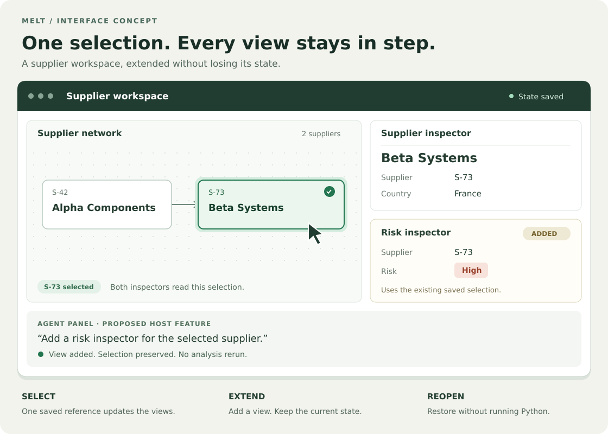
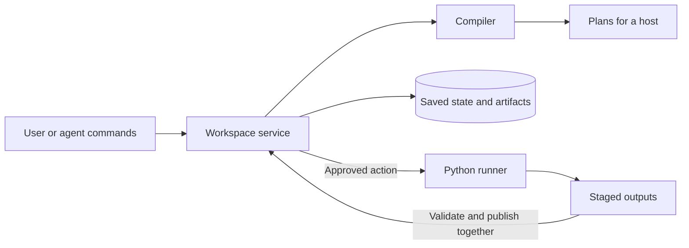

# Melt

**A language and runtime for saved workspaces that agents can change and people can use.**

Describe the data, views, controls, and actions once. Save the results and state.
Reopen the workspace without rerunning Python or calling a model.

[Run an example](#try-it) · [See the idea](#one-possible-interface) · [Understand the design](#how-it-works) · [Read the specification](SPEC.md)

## Why Melt?

An analysis often ends with a script, a chart, and instructions for running it again.
Melt keeps the inputs, parameters, views, and published results together in a saved workspace.

- **Keep using the result.** Read saved data and change selections without a model call.
- **Change the interface.** Add a view while preserving unrelated state and existing selections.
- **Run a calculation again.** Change a parameter and let its binding invoke a registered Python action.
- **Keep results consistent.** Publish a matching table and plot together, with their captured inputs and parameters.

Melt is for developers building data tools and agent interfaces with durable state.
The repository implements the language, compiler, workspace service, and Python execution loop on Linux.
**The desktop application is still planned.** Today, you use a command-line harness and exported images.

## One possible interface

A supplier workspace could show a graph and two inspectors that share one selection.
An agent could add the risk inspector without resetting the selected supplier.



*Interface concept, not a screenshot of a shipped application.*
[Example 3](examples/03-linked-views/README.md) demonstrates the state changes through terminal commands and a static graph export.
The window, clickable panes, and agent panel illustrate a future host.

## Try it

Use Linux with **Python 3.12**, **uv 0.10.x**, and **Node 22.19 or newer with npm**.
From the repository root, install the locked dependencies:

```bash
uv sync --locked
make probe-setup
make pele-setup
```

Run the first example:

```bash
uv run --locked python3 examples/01-saved-views/run.py
```

You see a saved expense table and a note:

```text
category | amount
Travel | 120.5
Software | 49.0
Supplies | 32.25
```

The example reopens the workspace and checks that both views survive.
It prints the saved directory and an `inspect` command you can copy.
**The terminal prints data; it does not draw the saved pane layout.**

### Then add computation and shared state

| Step | Run from the repository root | What you see |
|---|---|---|
| [1. Saved views](examples/01-saved-views/README.md) | `uv run --locked python3 examples/01-saved-views/run.py` | A table and note survive reopening without running an action. |
| [2. Sales analysis](examples/02-sales-analysis/README.md) | `uv run --locked python3 examples/02-sales-analysis/run.py` | Change the minimum revenue from 0 to 200. Three rows become two; a matching table and plot publish together. |
| [3. Linked views](examples/03-linked-views/README.md) | `uv run --locked python3 examples/03-linked-views/run.py` | Select a supplier, add another inspector, and keep the selection. Both inspectors follow the next selection. |

Example 2 grants execution permission to its included [analysis script](examples/02-sales-analysis/analyze.py) in a fresh workspace.
Open `before.png` and `after.png` in the printed directory to compare the plots.
Example 3 exports `network.svg`; selection changes appear in the terminal.
No example requires a model account or credentials.

Results use a fresh temporary directory by default. To keep them, choose a new or empty directory:

```bash
uv run --locked python3 examples/02-sales-analysis/run.py \
  --minimum 250 --output "$HOME/melt-sales-example"
```

This run keeps only the January row with revenue 300.
See the [example guide](examples/README.md) for saved files and changes you can try.

## How it works

A workspace combines a JSON document, saved state, and immutable artifacts.
The document describes the interface. The service owns changes and execution.

| Part | What it describes | Example |
|---|---|---|
| Source | A version of saved data | The imported sales table |
| Projection | A view of a source | A table, plot, or note |
| Parameter | A typed value that persists | Minimum revenue: `200` |
| Action | A registered calculation with declared inputs and outputs | Filter sales and plot monthly totals |
| Binding | What an event changes or invokes | A minimum-revenue edit requests analysis |
| Layout | Where a host should place the views | Table on the left, plot on the right |



Compilation validates definitions and produces plans. It runs no project code.
The service checks revisions and permissions, captures inputs, and starts an approved action in a fresh Python process.
The runner stages outputs. The service validates them and publishes eligible results together.
A host renders the plans and sends user events back through the service.

On restart, the service restores committed state and reports interrupted work.
It does not rerun project code automatically.

### Your analysis stays Python

This is the script from [example 2](examples/02-sales-analysis/analyze.py):

```python
import pandas as pd
import matplotlib.pyplot as plt
from melt import ui

sales = pd.read_parquet(ui.input_path("sales"))
selected = sales[sales["revenue"] >= ui.params["minimum"]]
monthly = selected.groupby("month", sort=True)["revenue"].sum()
fig, ax = plt.subplots()
monthly.plot(ax=ax)
ax.set_ylabel("Revenue")
ui.output("filtered", selected)
ui.output("monthly", fig)
plt.close(fig)
```

Melt supplies the captured inputs and parameters when its runner executes the script.
`ui.output` stages declared results; it does not change the interface or commit workspace state.
The example's [contract](examples/02-sales-analysis/contract.json) declares the inputs and outputs.
Its [view definitions](examples/02-sales-analysis/views.json) connect the action to controls and views.

## What works today

| Area | Status |
|---|---|
| `melt/v0.1` | Implemented schema, compiler, command protocol, and Linux workspace runtime. |
| Python execution | Registered scripts, permission checks, cancellation, captured inputs, and atomic result publication. |
| Persistence | Saved artifacts, revision checks, retry receipts, and restart recovery. |
| Shared selection and output subscriptions | Implemented under experimental `melt/semantic-draft-1`, with explicit migration from v0.1. |
| Rendering | Terminal inspection, PNG plots, and static SVG graph exports through the Pele adapter. |
| Native desktop host | Planned macOS integration. No clickable workspace application ships here yet. |

The semantic draft adds shared object references and views that follow an action's saved output.
It is an experimental language version. Existing v0.1 workspaces keep their behavior until you explicitly migrate them.
See the [extension proposal](docs/rfcs/001-semantic-interactions.md) and [implementation reference](docs/implementation.md#semantic-extension-draft).

## Measured performance

The [October 19, 2026 measurements](docs/performance/scale-fixes-2026-10-19.md) cover tables with three million rows and 20 columns:

| Operation | Median latency |
|---|---:|
| Cached page, one reader | 2.7 ms |
| Cached page, eight concurrent readers | 24.5 ms |
| Parameter edit during three concurrent sorts | 23.9 ms |

These are local service measurements with a warm filesystem cache, not display or network latency.
Concurrency uses threads calling one service; the standard input/output command loop remains serial.
Sorting and filtering still scan the full table and can exceed the retained cache budget in temporary memory.
The report includes before-and-after results, raw samples, limits, and reproduction commands.

## Develop and inspect

Run the full validation and test suite:

```bash
make check
```

This runs `scripts/check.sh`: dependency checks, protocol generation checks, canonical hash checks, and the test suites.
The [Round 1 gate](docs/gates/round-1-linux.md) records the original Linux acceptance run.
The [scale fix report](docs/performance/scale-fixes-2026-10-19.md) records a later run with 1,114 passing tests and two platform skips.

Validate a document, then compile it with its trusted source and action catalog:

```bash
uv run --locked python3 -m melt validate fixtures/valid/sales-full.json
uv run --locked python3 -m melt compile fixtures/valid/sales-full.json \
  --catalog fixtures/catalog.json --json
```

Validation without a catalog checks structure only. Compilation also resolves sources, registrations, types, and references.
For workspace commands, see the [harness reference](docs/implementation.md#command-line-harness).
Its manual sales workflow uses `--debounce-wait 400` to dispatch a bound action before the command closes the workspace.

| Path | Contents |
|---|---|
| [`examples/`](examples/README.md) | Three complete workflows and editable inputs |
| [`python/melt/`](python/melt/) | Schema, Python interface, runner, and compiler command line |
| [`runtime/`](runtime/) | Compiler, workspace service, execution, storage, rendering, and harness |
| [`protocol/`](protocol/) | JSON Schema and generated TypeScript and Swift models |
| [`tests/`](tests/) | Contract, integration, recovery, and native test coverage |

Change the schema vocabulary before running `make protocol`; do not edit generated models by hand.
Use `make benchmark-round1` for the baseline workload or `uv run --locked python3 scripts/benchmark_scale.py` for scale measurements.

## Go deeper

- [Language specification](SPEC.md): the authoritative `melt/v0.1` contract.
- [Implementation reference](docs/implementation.md): component behavior, entry points, harness commands, and recovery guarantees.
- [Semantic extension](docs/rfcs/001-semantic-interactions.md): shared selection, observers, and independent outputs.
- [Performance reports](docs/performance/scale-fixes-2026-10-19.md): measurements and remaining costs.
- [Design context](note.md): the broader product direction; the specification takes precedence.
